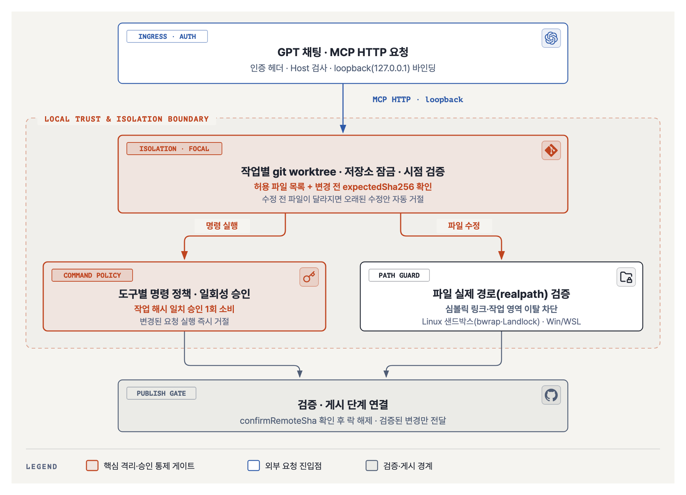

# Gram Coding Agent

ChatGPT / MCP 클라이언트의 코드 수정·검증·PR 게시 요청을 **인증 · 작업 격리 · 1회성 승인 · OS 샌드박스**로 통제하는 TypeScript/Node.js 기반 로컬 코딩 에이전트 MCP 서버입니다.

프롬프트 가드레일만으로는 AI의 타 작업 파일 수정, 심볼릭 링크를 통한 경로 이탈, 미검증 코드 게시를 막기 어렵기 때문에 실행·게시 안전 경계를 코드와 OS 수준으로 분리해 구현했습니다.

## 아키텍처 및 보안 경계



### 핵심 설계 원칙 (`AGENTS.md` 기준)

1. **진입·인증 경계 (`packages/mcp`)**
   - MCP HTTP 리스너는 `127.0.0.1` loopback 바인딩만 허용합니다(`0.0.0.0` 바인딩 금지).
   - Host 헤더 검사와 `timingSafeEqual` 기반 인증 헤더 검증을 통과한 요청만 MCP 도구로 전달합니다.
2. **작업 격리·시점 검증 (`packages/workspace`, `packages/repo-lock`)**
   - 작업마다 독립된 `git worktree`와 저장소 변이 락(`repo-lock`)을 할당해 타 작업 파일 오염을 차단합니다.
   - 파일 수정 전 허용 파일 목록과 `expectedSha256` 해시를 대조해 시점이 어긋난 오래된 수정안을 자동 거절합니다.
3. **명령 정책·1회성 해시 승인 (`packages/policy`)**
   - 명령어 파서(`command-parser.ts`)와 위험 분류기(`risk-classifier.ts`)로 명령을 분류하고, 승인이 필요한 작업은 `operationHash`가 일치하는 승인을 1회만 소비해 변조·재사용 요청을 차단합니다.
4. **경로·OS 격리 (`packages/filesystem`, `apps/execution-sandbox`)**
   - `realpath` 검증으로 심볼릭 링크 및 작업 영역 이탈을 차단합니다.
   - Linux 환경의 실행 샌드박스(`bubblewrap` / `Landlock` / `seccomp`)와 Windows/WSL 경계 헬퍼를 분리 설계했습니다.
5. **검증·게시 분리 (`packages/publishing`, `apps/agent`)**
   - PR 생성·CI 관찰 중에는 저장소 변이 락을 점유하지 않으며, 원격 푸시 커밋 SHA 확인(`confirmRemoteSha`) 후 락을 해제합니다.
6. **비밀값 경계 (`packages/secrets`)**
   - SQLite, Git, 로그, MCP 응답 어디에도 시크릿을 저장하거나 노출하지 않습니다.

## 모노레포 구성 (`pnpm` workspace)

| 영역 | 패키지 / 앱 | 주요 역할 |
|---|---|---|
| **Apps (`apps/`)** | `agent`, `execution-sandbox`, `filesystem-worker`, `windows-owner-consent-helper`, `windows-protected-local-viewer`, `windows-workspace-helper` | 에이전트 런타임 조립, OS 실행 샌드박스, 파일시스템 워커, Windows/WSL 경계 헬퍼 |
| **Ingress & Policy** | `packages/mcp`, `packages/policy`, `packages/secrets` | Loopback MCP HTTP 서버·인증, 명령 파싱·위험 분류·1회성 승인, 시크릿 경계 |
| **Workspace & Git** | `packages/workspace`, `packages/filesystem`, `packages/git`, `packages/repo-lock`, `packages/repo-registry` | 작업별 `git worktree`, `realpath` 경로 가드, 저장소 락·레지스트리 |
| **Execution & Publish** | `packages/task-engine`, `packages/shell`, `packages/verification`, `packages/publishing`, `packages/github` | 태스크 상태 머신, 명령 실행, 검증 코디네이터, 원격 SHA 확인 기반 PR 게시 |
| **Core & Infra** | `packages/domain`, `packages/persistence`, `packages/observability` | 도메인 모델, SQLite 영속성, 감사·관측 로그 |

## 코드 및 보안 문서 읽기 지도

| 보고 싶은 것 | 경로 |
|---|---|
| 아키텍처 불변 규칙 | [`AGENTS.md`](AGENTS.md) |
| MCP 서버 · Loopback 인증 | [`packages/mcp/src/server.ts`](packages/mcp/src/server.ts), [`packages/mcp/src/auth.ts`](packages/mcp/src/auth.ts) |
| 명령 정책 · 1회성 해시 승인 | [`packages/policy/src/policy-engine.ts`](packages/policy/src/policy-engine.ts), [`packages/policy/src/approval-service.ts`](packages/policy/src/approval-service.ts) |
| 작업별 `git worktree` · 경로 가드 | [`packages/workspace/src/worktree-service.ts`](packages/workspace/src/worktree-service.ts), [`packages/workspace/src/worktree-path.ts`](packages/workspace/src/worktree-path.ts) |
| 원격 SHA 확인 기반 게시 | [`apps/agent/src/verified-publishing.ts`](apps/agent/src/verified-publishing.ts) |
| 보안 위협 모델 · 불변 조건 | [`docs/security/threat-model.md`](docs/security/threat-model.md), [`docs/security/policy-invariants.md`](docs/security/policy-invariants.md) |
| 명령 실행 격리 설계 | [`docs/security/command-isolation-design.md`](docs/security/command-isolation-design.md) |
| 보안 · E2E 테스트 스위트 | [`tests/security/`](tests/security/), [`tests/e2e/`](tests/e2e/) |

## 사용 방법

### 1. 사전 준비 및 시크릿 설정

- **요구 환경**: Node.js `>=24 <25`, `pnpm@10.34.5`
- 실행 시 상태 디렉터리(`GRAM_AGENT_STATE_DIR`)와 시크릿 디렉터리(`GRAM_AGENT_SECRET_DIR`) 두 환경변수가 필수입니다.
- 시크릿 디렉터리 안에 MCP 내부 인증 키 파일 `mcp-internal-secret`을 준비합니다(`FileSecretProvider`가 기동 시 읽습니다).

```bash
# 1) 의존성 설치 및 빌드
pnpm install
pnpm build

# 2) 상태·시크릿 디렉터리 및 MCP 내부 인증 시크릿 준비
mkdir -p ~/.gram-agent/state ~/.gram-agent/secrets
chmod 700 ~/.gram-agent/secrets
openssl rand -hex 32 > ~/.gram-agent/secrets/mcp-internal-secret
chmod 600 ~/.gram-agent/secrets/mcp-internal-secret
```

설정 구조 예시는 [`config/agent.example.yaml`](config/agent.example.yaml)과 [`config/tunnel-client.example.yaml`](config/tunnel-client.example.yaml)을 참고합니다.

### 2. 에이전트 서버 실행

```bash
# 로컬 실행 (기본 바인딩: http://127.0.0.1:3847/mcp)
GRAM_AGENT_STATE_DIR=~/.gram-agent/state \
GRAM_AGENT_SECRET_DIR=~/.gram-agent/secrets \
node apps/agent/dist/main.js
```

- **Linux 상시 운영 (`systemd`)**: [`systemd/gram-coding-agent.service`](systemd/gram-coding-agent.service)와 [`systemd/openai-mcp-tunnel.service`](systemd/openai-mcp-tunnel.service)를 사용합니다(`UMask=0077`).
- **외부 ChatGPT / MCP 터널 연결**: OpenAI MCP Tunnel이 로컬 `http://127.0.0.1:3847/mcp`로 요청을 전달하며, `X-Gram-Agent-Auth` 헤더에 `mcp-internal-secret` 값을 담아 인증합니다. 상세 설정은 [`docs/operations/tunnel-setup.md`](docs/operations/tunnel-setup.md)를 참고합니다.

### 3. 기본 작업 흐름 (MCP 도구 호출 순서)

1. **상태 확인 · 저장소 등록**: `agent_health`로 기동 상태를 확인하고 `repo_register` / `repo_list`로 대상 저장소를 등록·조회합니다.
2. **태스크 생성 · 작업 격리**: `task_create`로 작업을 시작하면 독립 `git worktree`와 저장소 변이 락이 할당됩니다(`task_get`, `task_logs`, `task_result`로 진행 추적).
3. **코드 조회 · 시점 검증 수정**: `coding_step_get` → `coding_step_read`로 대상 파일과 현재 해시를 읽고, `coding_step_submit`으로 변경안을 제출합니다(`expectedSha256` 불일치 시 오래된 수정안 자동 거절).
4. **위험 명령 1회성 승인**: 정책상 승인이 필요한 명령은 대기 상태가 되며, `approval_list`에서 확인한 뒤 `approval_approve` / `approval_deny`로 처리합니다(`operationHash` 일치 승인 1회만 소비).
5. **검증 리뷰 · PR 게시**: `verification_review_get` → `verification_review_read` → `verification_review_submit`으로 변경 diff·시크릿 스캔 리뷰를 완료한 뒤, `github_pr_ensure` / `github_pr_checks`로 PR 생성과 CI 상태를 확인합니다(원격 푸시 SHA 확인 후 락 해제).

### 4. 주요 MCP 도구 요약

| 영역 | 주요 도구 |
|---|---|
| **에이전트 · 저장소** | `agent_status`, `agent_health`, `agent_logs`, `repo_register`, `repo_list`, `repo_inspect` |
| **태스크 · 코딩 단계** | `task_create`, `task_get`, `task_list`, `task_result`, `coding_step_get`, `coding_step_read`, `coding_step_submit`, `coding_step_fail` |
| **승인 · 검증 리뷰** | `approval_list`, `approval_approve`, `approval_deny`, `verification_plan`, `verification_run`, `verification_review_get`, `verification_review_read`, `verification_review_submit` |
| **코드 · Git · PR** | `code_search`, `file_read`, `file_write`, `file_patch`, `git_status`, `git_diff`, `github_pr_ensure`, `github_pr_checks` |
| **로컬 파일·프로젝트 (선택)** | `local_fs_*`, `local_project_list`, `local_project_read`, `local_dev_run` ([로컬 FS 가이드](docs/operations/local-filesystem-mcp.md) · [읽기 전용 프로젝트 가이드](docs/operations/local-project-readonly-mcp.md)) |

## 개발 및 테스트

```bash
# 정적 검사 (Lint + Typecheck)
pnpm lint
pnpm typecheck

# 단위 / 통합 / 보안 / E2E 테스트
pnpm test
pnpm test:security
pnpm test:e2e
```

## 검증 범위 참고

- 단위·E2E·보안 경계 회귀 테스트는 [`tests/security/`](tests/security/)와 [`tests/e2e/`](tests/e2e/) 및 [`.github/workflows/ci.yml`](.github/workflows/ci.yml)에서 자동화되어 있습니다.
- `docs/security/`의 일부 문서는 M5 하드닝 준비 기준선과 잔여 리스크(예: WSL은 Windows 호스트 보안 샌드박스가 아님)를 함께 기록하고 있습니다.
