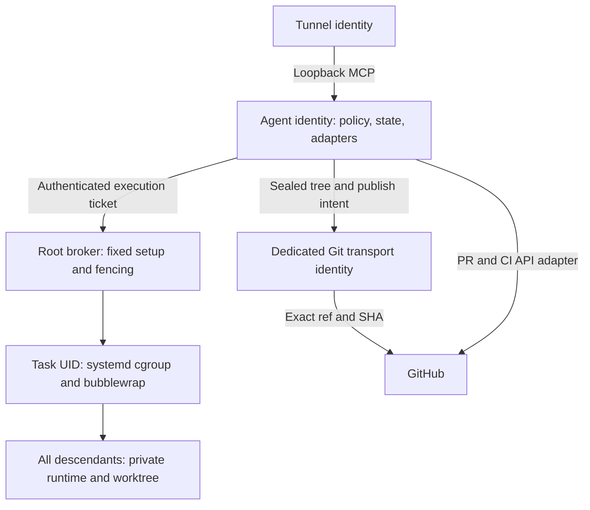

# Command execution isolation design

**Status:** PREPARATORY DRAFT — design only, not implemented or accepted.

**Date:** 2026-10-12.

**Source baseline:** M2 `d886ce3b98520e4c594e8da73b14e0bed7dbac3e`.

**Branch:** `docs/m5-command-isolation-prep`, independently based on M2.

**Related work:** [#119][i119], [#120][i120], [security invariants, PR #206][pr206], [boundary regression, PR #208][pr208].

**Goal:** Ordinary Task programs and all their descendants can develop and test a registered workspace without obtaining agent, GitHub, MCP, tunnel, or administrator credentials through files, environment, processes, descriptors, helpers, or control interfaces.

**Decision:** Use distinct Linux host identities, systemd supervision, and a fixed bubblewrap execution policy. Keep credential use and authoritative Git operations outside the ordinary worker. Default workers have a minimal Linux filesystem and no external network. This is a proposed Linux credential/process boundary, **not a claim that WSL is a Windows-host security sandbox**.

**Authorization:** This change adds only this document. It does not install software, provision identities, inspect real credentials, change a service, run an OS-isolation experiment, modify PR #208, or change production code/tests/configuration. Implementation, controlled laboratory provisioning, and target-device validation require separate approval and an independent implementation branch. [#112][i112] remains OPEN; #119/#120 and M5 are not complete. No existing PR is merged or changed by this work.

## 1. Evidence and the problem to solve

### 1.1 Evidence classes

| Label | Meaning | Evidence used here |
|---|---|---|
| SOURCE | Read at the exact M2 commit; establishes code behavior, not deployment state | [AGENTS.md][agents], the [architecture specification][spec], [M5 Task 4][m5], and the actual paths below |
| PRIOR-RUN | Historical executable evidence from the independent regression PR | PR #208 at `70aeb057ac5a2c37a206e2d8152c7124b7d5b48d`: 3 environment PASS / 3 file-denial FAIL; exit 1 |
| CONTRACT | Desired security rule, with its existing implementation limitations retained | PR #206 at `35f199d6b6960303f5909f19d65d3422ac2d8f3c`: [SEC-SEC-003][sec003] and [SEC-POL-004][pol004] |
| PROPOSED | Required future design or acceptance condition | All worker/broker/identity/snapshot changes in sections 3–12 |
| UNVERIFIED | Not established by this document or the prior regression | Native non-root workers, cgroups/namespaces/LSM on the target WSL2 machine, Windows interop denial, workload compatibility, and #120 sink coverage |

PR #208 used real `SecretProvider` and `CommandRunner` public interfaces and real direct Node, second-generation Node, and genuine `npm test` processes. Each route omitted five credential environment names, yet read all three provider-backed fake `0600` files and matched their canaries. Commands were Policy `ALLOW`, required zero approvals, and exited successfully. A mode-`0000` control failed with `EACCES`. The reported Linux UID was 0 with no effective capabilities; that supports the recorded owner-read/DAC result, **not native non-root or Windows/WSL acceptance**. No run was repeated for this design.

The fake tunnel file in #208 is deliberately provider-backed and owned by the fixture controller. It does **not** reproduce the root ownership of the production tunnel environment file. A separate root-owned tunnel fixture is required below. PR #208's existing CI succeeded but did not collect `tests/security/`; neither that CI nor a document-only PR proves OS isolation.

### 1.2 Actual baseline boundaries

| Actual M2 source | What it does | Remaining boundary |
|---|---|---|
| `packages/shell/src/command-runner.ts` | Evaluates policy/approvals; builds an environment allowlist; `NodeProcessSpawner` calls ordinary Node `spawn`; shell text uses `/bin/bash -lc` | No separate UID/GID, filesystem/PID/network namespace, cgroup lifetime, or general task-path confinement; retained HOME/PATH are ambient authority |
| `packages/secrets/src/file-secret-provider.ts` | Validates the final regular nonsymlink file and mode no broader than `0600`; reads it through `getForUse` | The owner's ordinary children can read the same file; `lstat` followed by `readFile` is not an atomic open/verification protocol |
| `apps/agent/src/main.ts` | Creates `FileSecretProvider`, MCP redactor, and one `CommandRunner` with `NodeProcessSpawner` for application composition | A blanket spawner replacement must distinguish development from trusted workspace/Git operations |
| `apps/agent/src/verification-review-command.ts` | Separately spawns bounded fixed Git reads and limits output | Its process is still outside an OS task boundary; killing one child is not descendant containment |
| `packages/github/src/github-client.ts`, `apps/agent/src/github-services.ts` | Leases `github.token` per HTTP request; disposes it; production fetch refuses redirects and has a 30-second timeout | This legitimate adapter use must remain possible without giving normal commands a token/helper/RPC |
| `packages/git/src/remote-service.ts` | Executes Git push and exact SHA/ref observation via a command port | It does not establish a dedicated, isolated Git credential transport; ambient Git configuration must not become the new authentication mechanism |
| `systemd/gram-coding-agent.service`, `systemd/openai-mcp-tunnel.service` | Both use `User=__GRAM_AGENT_USER__`; tunnel reads an `EnvironmentFile` | Unit templates do not separate agent and tunnel identities or ordinary tasks |
| `scripts/bootstrap-wsl.sh`, `docs/operations/tunnel-setup.md` | Describe agent-owned `0700` secret directory/`0600` MCP file and root-owned `0600` `/etc/gram-coding-agent/tunnel-runtime.env` | Root ownership protects the source file; the service manager passes its key to a same-UID tunnel process. Process/IPC access still matters. Actual installed files were not inspected |
| `packages/workspace/src/worktree-service.ts`, `apps/agent/src/command-adapters.ts` | Create linked worktrees beneath the agent home; run Git/worktree commands through policy | Shared Git metadata and `0700` ancestors are incompatible with simply changing the child UID |
| `packages/repo-lock/src/repo-lock-service.ts`, `lease-heartbeat.ts` | Maintain file/SQLite lease, heartbeat, and recovery transition | Heartbeat failure does not stop a running process tree; lease expiry is not proof that a writer has stopped |

These observations implement the distinction already recorded in SEC-SEC-003 and SEC-POL-004: environment exclusion is partial protection, and allowing an interpreter does not confine its scripts or descendants.

### 1.3 Requirements and coordination

[#119][i119] requires real command children to exclude fake GitHub, control-plane, MCP, and administrator environment credentials unless a dedicated adapter is authorized; administrator credentials must never enter the long-running application. [#120][i120] separately requires redaction/omission across command, clipboard, adapter, log, SQLite, audit, and MCP outputs. Blocking acquisition does not replace #120.

Before this draft, #112/#119/#120 were OPEN, #119/#120 and parent #113 had no CLAIM comments, the requested branch did not exist remotely, and the changed-file lists of 32 open PRs contained no `docs/security/command-isolation-design.md`. PR #206/#208 heads matched the pinned commits above. This is a point-in-time overlap check, not ownership of their implementation. M2 #77's real-device environment is outside this work.

## 2. Security contract and scope

The attacker controls repository files, scripts, compiler input, lifecycle hooks, binaries built in the workspace, and every descendant of an ordinary allowed command. The attacker may deliberately use Linux syscalls, copied Windows images, hostile Git configuration, links, sockets, daemonization, output growth, and timing races. Command names alone are not the boundary.

The trusted computing base is the Linux kernel/LSM, systemd, the pinned bubblewrap binary, immutable runtime files, a small execution broker, the controller/policy/persistence code, and dedicated credential adapters. The root broker can technically access host secrets; a narrow protocol and reviewed implementation reduce its attack surface, not its root authority. A compromised host root, compromised Windows account, kernel exploit, or compromised trusted adapter is outside the ordinary-worker claim.

Local design checks `ISO-01`–`ISO-09` below refine existing SEC rules; they are **not new accepted SEC invariants**.

| Check | Required behavior | Principal regression |
|---|---|---|
| ISO-01 | Worker host UID/GID differs from credential owners; no privileged groups/capabilities or credential-bearing inherited handles | Existing #208 file assertions; native identity/proc/FD tests |
| ISO-02 | Only registered Task files and approved runtime/scratch are accessible; no authoritative Git/state/secret/control mounts | Outside-task, common-Git, symlink/hardlink and mount-race tests |
| ISO-03 | Every untrusted descendant inherits the same boundary and remains in a supervised cgroup | npm, fork/exec, double-fork, `setsid`, timeout/kill tests |
| ISO-04 | Task request data cannot mint broker authority, change profiles/mounts/UIDs, or obtain credentials through an adapter | Peer credentials, ticket replay, confused-deputy and helper tests |
| ISO-05 | No Task path reaches Windows execution, Windows-backed files, host sockets or host loopback | Native WSL copied-image and IPC/network tests |
| ISO-06 | Mutation requires the current task/workspace/lease generation; no replacement writer before old domains are fenced | Lost lease, split state, crash/restart and UID reuse tests |
| ISO-07 | Publication uses the exact verified sealed tree, protected Git metadata and intended remote ref | Local-commit/hook/filter attacks; exact SHA and lock ordering tests |
| ISO-08 | Credentials remain adapter-private; every durable or returned output is bounded and secret-safe | #120 command/adapter/clipboard/log/SQLite/audit/MCP matrix |
| ISO-09 | Unsupported isolation, ambiguous cleanup or missing evidence prevents execution/acceptance | Setup-failure marker, unsupported-host and real-device gates |

Application DENY rules, operation-specific approval, loopback MCP, OpenAI `tunnel-client` exclusivity, protected-branch rules and lock-free PR/CI observation continue to apply. A user-approved ordinary command still cannot acquire agent credentials or leave this execution domain. Requests needing Windows or host administration must use a separate typed/approved capability; there is no generic `windows_exec` or privileged command escape.

## 3. Architecture decision and alternatives

### 3.1 Recommended composition



The agent remains the TypeScript modular application. Add a small native Linux execution broker as a separately installed privilege boundary, not a repository script running as root. Use Rust for the proposed broker/entry/credential-helper binaries to make bounded protocol parsing, descriptor ownership, `openat2`, pidfds and cgroup handling explicit. This adds a native build/deployment requirement; it is an intentional architecture change requiring implementation approval.

systemd creates a transient service and cgroup **before any repository code starts**. It launches a fixed trusted entry program as a pre-provisioned worker identity. bubblewrap constructs the private execution view. A second fixed entry inside that view applies the final syscall restrictions, reports setup evidence, waits for admission, closes setup descriptors, and then executes the approved program. A repository cannot supply either entry program or any privileged setup arguments.

### 3.2 Alternatives

| Alternative | Benefit | Decision and reason |
|---|---|---|
| Separate UID/GID plus ordinary `spawn` | Directly corrects same-owner `0600` access | Insufficient alone: leaves host files, loopback, sockets, Windows interop, process lifetime and cross-task authority to solve |
| systemd-only isolation with an explicit private root and equivalent namespaces | Fits existing deployment; avoids bubblewrap | Viable alternative after its own proof. Do not assume every needed namespace/property exists on the installed systemd, or that `ProtectHome`/`ProtectSystem` alone build the required allowlist. The selected first implementation uses bubblewrap for an explicit filesystem/PID/network construction and systemd for identity/lifetime |
| **systemd + non-setuid bubblewrap + distinct host task identities** | Composes cgroup supervision with a small explicit sandbox policy; no container daemon exposed | **Selected prototype.** Mandatory user-namespace/LSM support and a curated runtime are installation gates. No automatic fallback to host execution |
| OCI container runtime with fixed images | Useful toolchain reproducibility and standard namespace/resource configuration | Deferred: adds runtime/image/UID-map/socket operations and still needs task tickets, credential separation, Git sealing and WSL gates. No privileged containers, host namespaces, broad host mounts or runtime socket may reach a Task |
| A single shared worker account | Simple ownership management | Rejected for active tasks: same-UID proc/signal/files and retained artifacts create cross-task risks |
| systemd `DynamicUser` as the initial identity allocator | Automatic transient IDs | Deferred until retained worktree ownership and safe UID reuse are proven. This design chooses an explicit bounded pool and a durable allocation ledger |
| Separately managed VM outside WSL | A boundary designed to isolate hostile workloads from the Windows host | Required deployment direction when Windows-host containment is part of the acceptance claim; not automatically provisioned by this design |

bubblewrap supplies mechanisms, not a complete policy; OCI also requires explicit namespace configuration. These are reasons to define and test the full configuration rather than infer security from a tool name. [BWRAP][bwrap] [OCI][oci]

## 4. Execution identities and credential access

### 4.1 Proposed identity allocation

| Identity | Authority | Must not execute/access |
|---|---|---|
| `gram-agent` | MCP authentication, Policy/Task Engine, SQLite/audit, protected credential leases, GitHub HTTP adapter | Repository scripts, repository-selected plugins/helpers or ordinary shell commands under this UID |
| `gram-tunnel` | Official tunnel client, restricted tunnel runtime key, its copy of MCP shared secret | GitHub token, agent SQLite, ordinary Tasks; no administrator credential |
| `gram-publisher` | Fixed Git operations in protected Git storage; one bounded authorized Git transport lease | Agent home/SQLite/MCP/tunnel credentials; arbitrary task cwd, hooks, filters, config or command API |
| Root execution broker | Validate caller and registered resources, allocate worker slots, set up namespaces/cgroups, seal/export files, fence/recover | Repository code or caller-selected privileged setup; no generic secret-read or host-command method |
| `gram-task-N` / matching private GID | One active Task/workspace generation; task source, private Git shadow, scratch/cache | Any other role's identity, groups, credentials, sockets, state or workspace |

Provision the bounded identity pool once through a separately approved installer. Pool exhaustion queues work; it does not share an active identity. Do not grant sudo, docker, disk, systemd-manager, SSH-agent, interop or agent-readable groups. **Before unprivileged bubblewrap entry**, the privileged manager stage rejects or removes every supplementary membership except a redundant entry for the worker's private primary GID. Do not expect the inner worker to remove groups after its user namespace disables `setgroups`. An empty `SupplementaryGroups=` directive alone is not proof, because systemd also initializes NSS memberships. Verify actual host and final namespace groups before admission. Use fixed non-login accounts and no user session manager/PAM session for workers.

Reserve the slot until all associated cgroups are empty **and** its writable files/socket paths are deleted or moved into a sealed archive inaccessible to any reused slot. Retained dirty/unpushed/recovery worktrees keep their slot or a broker-owned sealed copy with a new generation. No recursive ownership repair through attacker-controlled paths. An uncertain archive/cleanup consumes the slot and blocks the repository until recovery.

The host UID mapping is the security identity. Mapping namespace UID 0 to `gram-agent` is forbidden. The selected profile explicitly sets final bubblewrap `--uid <worker-uid> --gid <worker-gid>` to the worker's nonzero host numeric IDs and records the single-ID maps. Only that worker's host IDs may be mapped; no subordinate mapping may include a credential owner or another worker. Trusted namespace setup can temporarily use capabilities inside its newly created user namespace; no such capabilities survive workload exec. Native acceptance records host IDs, final namespace IDs and actual groups independently.

### 4.2 Real and proposed secret paths

| Credential/object | Baseline template or API | Proposed authorized access | Ordinary Task view |
|---|---|---|---|
| GitHub API token | `FileSecretProvider` name `github.token`; actual configured secret directory is supplied to `startAgent` | Root-owned source credential; service-private copy for `gram-agent`; existing HTTP adapter leases it per request | No file, environment, helper, agent socket or process access |
| Internal MCP secret | Bootstrap `~/.config/gram-coding-agent/secrets/mcp-internal-secret`, agent-owned `0600` | Root-owned source with separate service-private copies for agent and tunnel; no shared worker-readable credential group | No mounted credential or host MCP connectivity |
| Tunnel runtime key | Root-owned `0600` `/etc/gram-coding-agent/tunnel-runtime.env`, then same-UID tunnel environment | Root-owned source; delivered only to `gram-tunnel`; never installed in the agent or worker environment | No source-file access or access to the receiving process/FDs |
| OpenAI administrator key | Explicitly forbidden in runtime by spec/#119 | No runtime credential ID, source file, environment entry or lease; bootstrap/management is outside this runtime | Always absent; an approval cannot add it |
| SQLite/WAL, leases, policy, installed agent/broker | Agent state and root-owned future installation | Controller/broker only; task outputs are treated as untrusted input | Neither readable nor writable; no bind mount |

For the proposed installation, store source credentials in a root-owned `0700` directory below `/etc/gram-coding-agent/credentials/`, each file `0600`. Use systemd `LoadCredential` to deliver only named per-service copies. Point `FileSecretProvider` at the agent's credential directory, preserving the same lease interface and names. Harden its open path using no-follow/descriptor verification and require the configured owner/mode; do not introduce a worker-facing `getForUse` RPC.

The existing tunnel YAML already supports `env:CONTROL_PLANE_API_KEY`. To avoid assuming a new client feature, the proposed fixed `gram-tunnel-exec` shim reads only the tunnel service's loaded credential and executes the pinned official client with that environment value. The key is not in unit properties, command arguments or diagnostics. The installer also renders the existing `X-Gram-Agent-Auth: file:` reference to the **tunnel service's loaded MCP copy**, supplies its nonsecret path and preserves the tunnel ID; it does not assume client-side interpolation or fall back to the old agent-owned path/shared credential group. A fake authenticated MCP success test must coexist with worker denial of both loaded copies.

The client necessarily holds the runtime key while running; separate UID, absent worker proc/socket access, disabled core dumps, and service-private credentials protect that receiving process. A future file-native client integration can replace the shim only after version-specific verification. It is not needed to justify this design.

systemd documents service-manager credential delivery and the exposure risk of putting secrets in unit environment settings. A root-owned environment source alone does not remove the secret from its consumer's environment. [SYSTEMD-EXEC][sdexec]

## 5. Broker protocol and launch admission

### 5.1 Controller-only channel

Use a root-owned Unix `SOCK_SEQPACKET` socket under `/run/gram-executor/`, inaccessible to workers. Authenticate each connection using kernel peer credentials plus the expected controller service instance/pidfd; a caller-provided UID, Task ID or JSON claim is not authentication. Bind each admitted command to the active controller boot/session. No socket activation descriptor, connected control FD, namespace FD, token, manager connection or signing key is inherited by untrusted code.

Only the agent can request ordinary execution. Task output is data and is never interpreted as a broker request. `category: 'GIT'`, a typed TypeScript value, or a claimed `ALLOW` cannot select privileged execution from an external caller. Trusted Git and Windows adapter methods are separate application capabilities with fixed operations.

The broker resolves registered workspace handles, immutable profiles and UID slots itself. Requests may not specify a host UID/GID, host bind source, runtime root, systemd property, namespace handle, capability, seccomp program, setup executable, extra inherited FD, alternate service name or credential name. Registration is controller-only, rooted in an installer-configured storage tree, and uses safe descriptor-based lookup. Repository paths never become privileged command text.

### 5.2 Proposed interfaces

These interfaces do not exist in M2. Put pure types in `packages/domain`; keep application orchestration in `apps/agent`/`packages/task-engine`, Linux client code in `packages/shell`, and OS authority in the native broker.

```ts
interface ExecutionBinding {
  taskId: string;
  repoId: number;
  workspaceId: string;
  workspaceGeneration: number;
  leaseEpoch: string;             // opaque broker fencing generation
  controllerSession: string;
}

interface AuthorizedTaskExecution {
  version: 1;
  binding: ExecutionBinding;
  requestId: string;              // idempotency/replay binding
  operationHash: string;          // existing Policy/approval evidence
  executionDigest: string;        // command + cwd identity + profile + binding
  approvalBindingKey?: string;    // version-2 approval, required for NEEDS_APPROVAL
  profileId: 'linux-node-v1';
  cwdRelative: string;            // beneath the registered workspace
  command: { executable: string; args: readonly string[] }
    | { shellText: string };
  deadlineMs: number;             // bounded by root-owned profile and lease
}

interface ExecutionReceipt {
  executionId: string;
  executionDigest: string;
  binding: ExecutionBinding;
  unitId: string;
  bootId: string;
  hostPid: number;
  processStartTime: string;
  hostUid: number;
  hostGid: number;
  profileDigest: string;
  runtimeDigest: string;
  namespaceEvidenceDigest: string;
}

interface ExecutionSupervisor {
  start(ticket: AuthorizedTaskExecution): Promise<ExecutionReceipt>;
  stop(executionId: string, reason: string): Promise<void>;
  waitQuiescent(executionId: string): Promise<{
    populated: false; exitCode: number | null; terminationReason: string;
  }>;
}
```

`AuthorizedTaskExecution` above describes development admission to a `MUTABLE` generation. Sealed verification has a separate controller-coordinator port, `runSealedVerification`, bound to a broker-registered immutable snapshot, the exact `VerificationBinding` and a command entry in its approved verification plan. This port uses the same policy/approval binding, isolation setup, receipt and supervision contracts, but requires `SEALED` source with separate non-published output mounts. The coordinator creates its protected intent; task data cannot select it through a role/category/boolean on a generic execution request. Its privilege is read-only access to that candidate, not permission to reopen source mutation or acquire credentials.

Wire messages have a fixed version, explicit size/count limits, validated UUID/repository identity, bounded UTF-8/NUL-free argv and shell text, and unknown-field rejection. Cap each request at 64 KiB. Resolve an executable inside the approved runtime; do not perform privileged PATH search. Shell text still goes through the existing parser/approval gate, then runs non-login `/bin/bash --noprofile --norc -c` inside the worker. No host `.profile`, `.bashrc`, `BASH_ENV`, `ENV` or repository startup hook participates in setup.

The existing operation hash does not bind this new execution context. Retain it as classification evidence and define canonical `executionDigest` over command, resolved cwd/workspace generation, task/repository, lease epoch, profile/runtime digests and resource/deadline limits. Define version-2 `approvalBindingKey = SHA256(canonical({version: 2, operationHash, executionDigest}))`. Store all three values and use the same binding in request, user-visible approval details, approve/deny, atomic consumption and admission. A changed bound field requires a fresh matching approval when Policy returns `NEEDS_APPROVAL`; simply evaluating the old operation hash again is insufficient. Profile capability failure is rejected before asking for or consuming an approval.

Extend the approval repository/ports/schema to consume the exact task/binding and associate that consumption atomically with its execution request ID. Duplicate or parallel consumption cannot create another launch. Legacy approvals without this binding cannot authorize isolated execution; expire them for new use while retaining audit history and request a new approval when needed. Idempotency is separate: retrying the identical admitted request returns its receipt/state without consuming again or executing twice. A failed setup never turns a spent approval into a reusable ticket.

### 5.3 Setup transaction

1. Confirm Policy, profile capability, persisted Task/workspace identity, current Repo Lock ownership and the selected port's phase-specific protected intent: `MUTABLE` for development, exact `SEALED` candidate/plan for coordinator-issued verification. For `NEEDS_APPROVAL`, atomically consume the exact version-2 approval binding with the credential-free execution intent.
2. Broker validates the controller and its current epoch, writes a durable launch intent and reserves a UID. Its root-owned ledger is the launch/fencing authority; the agent SQLite row alone cannot authorize a replacement writer.
3. systemd creates the named service/cgroup with fixed properties and registered input mounts. Root-manager bind setup exposes only the registered source directories to the trusted worker launcher, without chmod of the agent home. No untrusted child exists before cgroup membership.
4. The fixed launcher builds bubblewrap's namespace, runtime and cwd. Its fixed in-sandbox entry installs final restrictions and attests identity, mappings, groups, capabilities, namespace IDs, mount profile and open-FD allowlist. The broker correlates this with the real host PID/pidfd, unit and start time.
5. Recheck epoch/deadline and persist RUNNING/admission. Only then release the entry's execution barrier. Close setup/control descriptors before exec; keep only controlled standard streams. Raw stdout/stderr must already be connected to the mandatory bounded capture pipes described in section 6.4.
6. Setup failure terminates the whole service, records a bounded error code and proves the authored workload-start marker never occurred. It must not retry through `NodeProcessSpawner`.

An app crash between any two steps leaves a durable intent to reconcile. The broker starts closed after restart and inventories its exact unit prefix/cgroups/ledger before accepting new work. Neither PID reuse nor a missing app row proves an old job is gone.

## 6. Filesystem, process and network policy

### 6.1 Fixed worker root

The initial `linux-node-v1` profile is immutable, root-owned and version/digest bound, initially targeting native Linux x86-64. It contains reviewed Node 24, genuine npm, the repository's pnpm version, Git, Bash/sh, core utilities, Python 3/make/C/C++ build prerequisites for native addons, necessary libraries, CA data and minimal nonsecret passwd/group/locale files. The future runtime manifest pins the complete artifact and tool versions; a different CPU/ABI needs a separately reviewed profile. Use a curated root, not a read-only bind of `/`, the agent checkout or a developer home. A read-only secret mount still leaks its contents.

| Worker path/view | Access | Construction rule |
|---|---|---|
| Runtime binaries/libraries | Read/execute, immutable | Root-owned image/artifact digest; no system/user Git, npm, shell or SSH credentials/config copied in |
| Exact registered worktree absolute path | Task writes during development | Synthetic private ancestors plus only this task directory; preserve the persisted path, not a broad agent-home mount |
| Task Git shadow | Task-local only | Complete copied metadata/objects; no alternates, shared writable refs, hardlinks to authoritative objects, or host `.git` pointers; see section 7 |
| HOME, TMPDIR, cache, XDG runtime | Private writable directories | Generated from the job identity; no host values or previous task cache reuse |
| `/proc` | Fresh PID-namespace view | Needed self metadata only; no host proc mount, process roots, namespace handles or host FD access |
| `/dev` | Minimal null/zero/random/urandom and required private terminals | No host devices, block devices, GPU/WSLg, fuse or host TTY |
| `/run`, `/sys`, agent/state/secret paths, other homes/tasks | Absent or inaccessible | No host run/sys/cgroup-control mount; no Docker, D-Bus, SSH, broker, editor or agent sockets |
| Windows-backed filesystems, `/mnt/c`, `/mnt/wsl`, `/run/WSL`, `/init` | Excluded | Allowlisted mount sources, not a blacklist of one Windows drive letter |

Prepare writable directories with the assigned task ownership before exposure. The host agent home stays private. Fixed empty npm user/global configs, genuine Node/npm paths, shell and task cache must work for direct/descendant/lifecycle execution. Worker-controlled npm settings and installed project tools remain untrusted and execute inside the same boundary.

All broker lookup/export/cleanup uses registered directory descriptors and no-follow traversal (`openat2` with beneath/no-magic-link constraints, plus object/type/mount identity verification). Reject traversal, unexpected mounts, special files, and multi-link published files. Do not follow symlinks into the host while scanning, copying, chowning or deleting. Relative in-workspace source symlinks may be represented as link data after target validation; they are never dereferenced by privileged export. Replacing an ancestor or mount between validation and use invalidates the handle/generation. No `safe.directory=*`, recursive broad chmod/chown, or canonical-repository bind is a compatibility fix.

### 6.2 Namespace and privilege contract

Require mount, user, PID, IPC, UTS, network and cgroup namespaces explicitly. With bubblewrap, request mandatory namespace options rather than relying on `--unshare-all`'s optional `*-try` behavior. Pin/check the installed binary and LSM support. Drop worker capabilities, set `no_new_privs`, prevent nested privilege/namespace creation after setup, and require an empty effective/permitted/inheritable/ambient/bounding capability result at workload exec. All host mappings remain the allocated task identity. [BWRAP-MAN][bwrapman] [NNP][nnp]

The systemd launch service uses the worker `User`/`Group`, validated groups, explicitly empty `CapabilityBoundingSet=` and `AmbientCapabilities=`, `NoNewPrivileges=yes`, `KillMode=control-group`, `SendSIGKILL=yes`, `Restart=no`, `Delegate=no`, finite `RuntimeMaxSec`/`TimeoutStopSec`, `TasksMax`, `MemoryMax`, CPU and FD limits. Require a root-owned non-setuid bubblewrap/entry binary with no file capabilities; use `--cap-drop ALL` and verify all final capability sets after namespace setup. The host bounding-set setting alone is not evidence of the final namespace sets.

Every transient worker/publisher unit uses `BindsTo=gram-coding-agent.service gram-execution-broker.service` with matching `After=` dependencies. This lifetime linkage complements independent epoch deadlines and startup reconciliation; no unit restart can re-execute a previous ticket. Its fixed launcher may need namespace setup syscalls before the final seccomp filter; do not copy a filter that blocks setup and then disable isolation to make it run. The final untrusted stage has no setup capabilities or manager access. [SYSTEMD-UNIT][sdunit]

Initial budget proposal: 15-minute command maximum, 256 tasks, 2 GiB memory, 2 CPUs, 1,024 FDs, 8 MiB per output stream; a root-owned reviewed profile may lower or explicitly change these. Terminal/window sharing is absent. `--new-session` and no inherited host TTY prevent terminal injection. JIT execution is required for Node, so do not blindly enable `MemoryDenyWriteExecute` or mark every build-output path non-executable.

The post-setup seccomp profile must allow ordinary Node threads and subprocesses while denying mount/namespace changes, `setns`, ptrace/process-memory access, `pidfd_getfd`, handle-based filesystem escape, kernel/module/BPF/perf/keyring administration, and direct VM/hypervisor socket families. Deny namespace flags in `clone`; handle `clone3` explicitly (initially `ENOSYS` to use the validated libc fallback). Block unreviewed `io_uring` interfaces and `TIOCSTI`.

The initial filter accepts only `AUDIT_ARCH_X86_64` native syscall dispatch, rejects the x32 syscall-number bit and all compat/unknown architectures, and defaults to denial for unreviewed syscall numbers and multiplexed paths. Syscall number checks without an architecture check are not acceptable. The trusted inner entry remains single-threaded from final filter installation through exec; the executed program's later threads/descendants inherit that filter. Any future multithreaded setup requires successful TSYNC for every thread; a positive unsynchronized TID is a failure, not success. Filter-install/ABI validation failure never releases the workload barrier. The compiled architecture-specific filter and real Node/build behavior remain implementation gates. Add authored native direct/descendant probes for alternate-ABI denial and a setup-failure workload marker. [SECCOMP][seccomp] [SECCOMP-SYSCALL][seccompsyscall]

### 6.3 Network and IPC

Default workers have their own loopback and no veth/default route, host forwarding or proxy. Task-local servers and test clients may communicate inside the job. They cannot reach host `127.0.0.1:3847`, Windows host networking, other tasks or external registries. Allow required local AF_UNIX/IPv4/IPv6 use only within this topology; deny AF_VSOCK/other host integration families in the final filter.

Filesystem sockets and inherited connected FDs require separate protection from network namespaces. No host pathname socket is mounted, and only controlled standard streams survive setup. No worker-visible endpoint can forward arbitrary requests to the agent, GitHub credentials, systemd or Windows. [SYSTEMD-EXEC][sdexec]

For normal package work, first support lockfile-pinned **public**, credential-free dependencies materialized into task-local caches by a separate bounded acquisition path; install/lifecycle code still runs as the worker. An approved acquisition request identifies a registry/package/integrity from validated metadata, not an arbitrary URL/proxy header. Reject redirects to private/link-local/host destinations, Git transports, local files and unknown registries; check resolved addresses at connection time. No private npm/GitHub token, shared authenticated cache or host package-manager configuration reaches the worker. Cache/archive extraction is treated as untrusted file input with the same safe traversal rules.

Private dependency acquisition and unrestricted internet integration tests are initially unsupported. If later required, they need a separate credential-scoped adapter and data/egress review. A development-server preview can later use a typed, task-bound, one-direction port relay without host-network sharing, but it is not part of the initial accepted profile. Network-dependent work must report this compatibility limit rather than enable `--share-net`.

### 6.4 Raw output must not bypass #120 through systemd

The selected launch contract explicitly passes broker-owned stdout/stderr pipe FDs through supported manager FD-binding APIs. Worker/publisher streams flow through bounded in-memory capture to the controller's registered-secret redaction/omission boundary, then to `OutputCapture`, audit, SQLite and MCP. Missing pipe binding fails setup before admission; there is no raw `journal`, file, socket-log or TTY fallback. If the controller/redactor is unavailable, discard raw data, terminate the job and record only a fixed error code. Command text and credentials never become unit descriptions or diagnostic properties; the fixed entry receives its bounded launch payload over a private setup descriptor, which is closed before workload exec.

The credential helper's protocol output goes exclusively to its trusted Git consumer through a private bounded channel, never a log collector. Its stderr and the publisher's stdout/stderr use the protected capture path. For the long-lived controller, tunnel and root broker, configure raw `StandardOutput=null` and `StandardError=null`; intentional operational/audit records use a separately bounded structured logger after redaction or omission. Service-manager metadata may contain fixed executable/unit IDs and exit reasons, not request/credential content. This deliberately sacrifices uncaptured raw diagnostics rather than persisting them by default.

Disable core dumps (`LimitCORE=0` and the applicable process dumpability control) for **all** credential-bearing controller, tunnel, publisher/helper and broker roles, as well as workers. No credential-bearing crash report is an allowed debugging artifact. systemd's default stdout destination can be the journal, so application log tests alone are insufficient. T6 must test generated journal/service diagnostics, core-dump absence and application sinks with split fake secrets on both streams and on failure paths. [SYSTEMD-EXEC][sdexec]

## 7. Git, verification and legitimate credential use

### 7.1 Keep authoritative Git out of the ordinary task

Linked worktrees share repository configuration and common metadata. Exposing that common directory writable lets a Task change hooks, refs, helpers and another worktree's state. Git ownership exemptions are not a sandbox. [GIT-WORKTREE][gitworktree] [GIT-CONFIG][gitconfig]

Retain one broker-registered real host linked worktree per Task. Inside the worker, bind only its content and replace its `.git` view with a fixed indirection to **task-private Git metadata** copied from the authorized base SHA. Preserve the exact absolute cwd via synthetic ancestors, so current root/path equality guards can remain meaningful. The shadow contains no host absolute pointers, credential config, alternates or shared hardlinks. Local Git status/diff/log and disposable local commits work inside this view; they do not change the authoritative task branch or authorize publishing.

Trusted adapters never execute Git in a task-writable cwd, load its Git config/hooks, or authenticate a task-selected remote. Local candidate preparation, inspection and commit construction are credential-free. Authenticated transport necessarily parses remote protocol and may receive objects while using a credential; that Git process is part of the restricted trusted publisher domain, using a pinned/maintained Git binary, bounded operations and protected quarantine for incoming data. Validate fetched objects before authoritative import; failed validation cannot produce success or handoff evidence. Disable hooks, filters, textconv/ext-diff, fsmonitor, replace objects, config includes, URL rewrites, pagers, signing and arbitrary remote/credential helpers in the protected contexts. Reject unsupported LFS/submodule/filter-dependent publication until separately designed; do not execute their helpers with adapter credentials.

### 7.2 Preserve exact verification evidence

M2 `apps/agent/src/verification-snapshot.ts`/`verification-coordinator.ts` and `verified-publishing.ts` bind evidence to workspace identity, Git HEAD and source state. After introducing a private Git shadow, its HEAD/index/status are attacker-controlled and cannot be that authority. A Task could commit locally to hide changes from `git status`.

The future authoritative sequence is:

1. Record protected base SHA **B**, task branch, workspace generation and permitted publication paths under the Repo Lock. Ordinary edits occur in the content view.
2. Durably change the broker-owned workspace generation from `MUTABLE` to `SEALING`, closing **all candidate-source mutation admission**: development commands, controller `FileService`/patch calls, workspace administration and Git operations that could write the task's source view. Every controller file mutation must use the broker's task/generation-bound port; direct agent filesystem writes bypassing that port are forbidden. Drain already admitted mediated writes and stop all writer cgroups. Only after both are quiescent may the broker export bounded, no-follow snapshot **S** of candidate input files, modes, symlink data and deletions against B. Finish with an immutable manifest and `SEALED` state. Unexpected changes, incomplete drains or a changed generation abort sealing and invalidate dependent verification. Derive the diff from protected B and actual snapshot bytes, ignoring the task's Git index/refs/config.
3. Build exact candidate tree **T** from S and the explicit approved paths in protected, credential-free staging. Files required by the verification plan must be in T or explicitly immutable runtime inputs; omitted worktree files cannot influence evidence for T.
4. Admit required verification/review only through the coordinator-issued `runSealedVerification` port against a fresh isolated view of exact T and its protected `VerificationBinding`/plan. Source and configuration are read-only; declared build-output/cache/temp mounts are writable and cannot become published source. Use a private Git shadow reflecting T/B for tool compatibility. Include runtime/profile digests and snapshot identity in the verification binding. Ordinary development admission and controller source writes remain closed. A plan requiring source mutation or an undeclared output path fails the profile; changing the candidate requires a new snapshot and verification.
5. Construct commit **C** with parent B and tree T using fixed Git plumbing on explicit byte inputs, such as `hash-object --no-filters`, `mktree` and `commit-tree`. Do not re-run `git add`/`git commit` against the untrusted worktree. Recheck committed tree, parent, allowed paths, review/plan IDs and snapshot fingerprint; never reuse a task-private HEAD as proof.
6. Import C into protected authoritative storage, compare-and-swap only the intended task branch B→C, and reconcile its protected index/registered workspace generation without checkout/filter execution. Journal these steps. A mismatch or crash leaves recovery state rather than silently changing the publication parent.
7. Publish exactly C; confirm the exact intended remote `refs/heads/<branch>` resolves to C through the trusted transport; persist confirmation. Release mutation ownership only after all mutators are quiescent and the handoff record is durable. PR creation and CI observation then run without the mutation lock.

This changes verification/workspace authority and is **not drop-in compatibility**. Existing SHA/root/path checks must be strengthened to use protected bindings, not removed. A proposed `VerificationBinding` contains `baseSha`, `candidateTreeSha`, `snapshotId`, `manifestSha256`, `workspaceGeneration`, `planId`, `runtimeDigest`, and `profileDigest`; publication proves C's parent/tree correspond exactly. Recovery reconciles B/T/C, the protected branch/index and recorded generation before resuming. Task-local commits, untracked files, staged deletions and a changed shadow HEAD cannot exclude actual edits from review.

Sealing remains exclusive through verification/publication. Reopening development creates a new writable generation and invalidates old writable handles and candidate evidence. The mediated file port accepts bounded relative paths/bytes and expected content identity, resolves them beneath the registered directory, and never exposes a generic privileged filesystem API. Race and crash tests include a patch accepted just before `SEALING` and one requested afterward: the former completes before S or aborts sealing, and the latter performs no write.

Protected staging, commit construction, B→C branch compare-and-swap, index reconciliation and publication are separate fixed adapter transitions authorized by the sealed intent and their recorded phase. They may write only the registered protected staging/Git metadata or the bound remote ref; they never execute a checkout/filter or write/reopen the sealed candidate source. They are not ordinary Task command admission or a general exception to the seal. T5 must prove successful sealed verification and protected reconciliation while generic commands, forged verification-purpose requests and `FileService` writes remain denied and candidate bytes stay unchanged.

### 7.3 GitHub adapter and Git transport

Keep the current GitHub HTTP adapter's lazy `github.token` lease in `gram-agent`. No normal worker can reach its internal methods, FileSecretProvider or an HTTP proxy exposing arbitrary GitHub operations. PR/CI requests remain typed and tied to the registered repository/task. Preserve production redirect refusal, finite timeout, bounded secret-safe errors and lease disposal.

For authenticated fetch/push/`ls-remote`, add a dedicated `gram-publisher` process with an immutable minimal runtime and protected object storage, separated from both task workers and agent secrets. The controller sends a fixed operation (`fetchRegistered`, `pushExact`, `confirmExact`), not arbitrary Git argv, cwd or URL. The broker resolves destinations from protected state and validates them through the trusted repository-identity adapter. Persist separate, operation-bound intents before transport:

- `FetchIntent` binds the immutable GitHub repository ID, registry-binding revision, canonical HTTPS authority/path, task/controller session, current repository lease/execution epoch, allowed refspecs and protected quarantine registration. Initial fetch precedes worktree creation and verification, so it requires neither a workspace generation nor C/`VerificationBinding`; do not fabricate those values. It can authorize only bounded fetch and validated import into the registered protected repository, never push or publication confirmation.
- `PublishIntent` binds that same destination identity to the full intended remote ref, C, task/workspace generation, lease/execution epoch and `VerificationBinding`. Only this intent can authorize `pushExact` and its `confirmExact`/recovery observation. Protected-branch force push/delete remains DENY; direct main needs its existing explicit grant.

Confirmation/recovery uses the **original** intent and destination, never a fresh URL resolved from changed registry state. Identity mismatch at the old path, a changed binding, unsupported rename/transfer resolution or inability to establish that destination remains recovery-blocked. Matching SHA/ref in a different repository cannot discharge the original attempt. Persist the identity observations with confirmation; namespace changes at the remote remain errors to reconcile, not permission to redirect credentials or infer success.

Provide the token only to a fixed credential helper through a private descriptor for that one authorized transport operation. Its protocol validates HTTPS, exact host and repository path, enables path-aware credential matching, bounds helper calls to the live operation, and never stores credentials. `get` may service a bounded legitimate retry within that operation; `store`/`erase` cannot create an ambient cache. Close/revoke descriptors on completion, timeout or epoch loss. No token in argv, unit properties, log/audit/SQLite, worker env, writable helper script or Git config. No GCM, SSH-agent, Windows helper, interactive prompt, proxy, redirect or URL rewrite fallback.

The transport namespace permits only the fixed GitHub transport destination with TLS verification; redirect and unexpected endpoint attempts fail. Token use is part of that adapter's authority, not a generic runner exception. Tests must prove successful pre-workspace authenticated fetch, subsequent verified push and denied ordinary task acquisition simultaneously. A fetch intent presented for push/confirmation is rejected; interrupted fetch recovery uses its original destination/refspec/quarantine binding and cannot discharge a publish attempt. Reject malformed/oversized protocol/object data, forbidden helpers and failed quarantine validation without credential output or authoritative import. Git's path-aware helper matching and helper operations are documented separately from generic Git configuration. [GIT-CREDENTIALS][gitcredentials]

## 8. WSL2 applicability and host boundary

Microsoft states that WSL is not a security sandbox for untrusted code and that same-user distributions are not a boundary from the Windows host. Configuration switches and containers inside WSL do not establish that guarantee. Therefore this design can only be accepted on WSL as a **measured Linux credential/task isolation profile**, under the stated trusted-host assumptions. If the required claim is containment of actively hostile code from Windows itself, move the worker to a separately managed VM outside WSL with restricted shares/credentials; passing this test matrix cannot replace that boundary. [WSL-SECURITY][wslsecurity]

WSL supports systemd, but installed WSL/kernel/systemd/LSM features must be measured. Ubuntu's user-namespace restrictions can affect non-setuid bubblewrap. Missing support is `ISOLATION_UNAVAILABLE`, not permission to disable an LSM, relax a sysctl or run outside the profile. [WSL-SYSTEMD][wslsystemd] [UBUNTU][ubuntu]

### 8.1 Concrete interop bypass risks

WSL2's Windows executable handler is registered through `binfmt_misc` at VM level. `/init` uses interop sockets under `/run/WSL` and can search parent-PID sockets when `WSL_INTEROP` is unset. Thus environment cleanup, `.exe` command classification, and PATH removal cannot contain interpreter-spawned Windows programs. Linux's `binfmt_misc` `F` flag can retain an interpreter across namespace/root changes, so hiding the `/init` pathname alone is also insufficient evidence. [WSL-INTEROP][wslinterop] [BINFMT][binfmt]

The worker omits Windows/WSLg mounts, interop sockets and `/init`; denies host/hypervisor socket families and inherited integration FDs; uses a fresh PID/proc/network view; and cannot modify kernel binfmt registrations or namespaces. Inspect the target's nonsecret registration metadata and actual mount/namespace features in a future controlled lab. First establish a paired positive control: the same authored harmless Windows canary and Windows-side marker/process observer must work **outside the worker in that separately approved lab**, under its recorded interop mode. Then prove no Windows effect inside the worker through direct, Node, real npm, copied/renamed image, alternate absolute/relative/FD, and attacker-supplied `WSL_INTEROP` routes. A bad binary, unavailable route, disabled/missing interop or failed observer is unsupported/failure, not GREEN denial. Any observed Windows launch blocks this profile; successful negatives still do not establish a Windows-host security boundary.

`/mnt/c` is only one possible mount location. Do not expose DrvFs/9p/Windows-backed sources anywhere in the runtime, worktree or cache. DrvFs permissions without metadata derive from Windows permissions, so Linux UID separation does not automatically isolate Windows files. Test configured/alternate mount locations and reject a registered workspace on an unsupported filesystem. [WSL-PERMISSIONS][wslpermissions]

NAT and mirrored networking have different host reachability, including localhost behavior. Test the actual mode with synthetic host endpoints over IPv4/IPv6; no assumption that a particular gateway address is unreachable substitutes for a network namespace. [WSL-NETWORK][wslnetwork]

### 8.2 Existing Windows integration

Ordinary Tasks cannot invoke PowerShell/CMD/Windows binaries even if they synthesize the command indirectly. M2 has the path-conversion adapter; typed open/reveal/clipboard are planned M4 capabilities, not an implemented `packages/windows-integration` package at this baseline. Existing path conversion and future typed operations must use separate trusted adapters. Raw Windows commands still require their existing approval policy and a separately designed execution domain; the ordinary worker broker cannot implement them. Path conversion uses registered workspace identity, not arbitrary host paths. Clipboard output still needs the independent #120 redaction contract.

Changing Linux ownership can also prevent Windows editors/Explorer from reading a task path through the distribution's default user. Do not fix this with broad agent-home permissions or a Windows-backed writable mount. A later typed export/preview capability can expose an explicitly selected sealed copy; bidirectional Windows editing requires its own generation/write-admission design. Native compatibility remains pending and must use a later isolated acceptance environment, without altering M2 #77's active setup.

## 9. Lifetime, Repo Lock and recovery

### 9.1 Two authorities with different purposes

The existing Repo Lock protects mutation/publication ordering. A broker execution epoch protects process admission and fencing. Neither replaces the other. Development commands and controller-mediated file/patch/workspace mutations require both current bindings and a `MUTABLE` workspace phase; even a command labeled read-only can spawn a writer. The broker serializes phase transitions and admission, drains in-flight writes, and refuses candidate-source mutations to `SEALING`/`SEALED` generations. Only the coordinator-issued read-only sealed-verification port and fixed protected Git/publication transitions in section 7.2 may proceed in their recorded sealed phases, under the same lease/epoch and process-isolation requirements. Neither accepts a task-supplied purpose as authority or reopens the candidate.

Maintain a root-owned durable broker ledger keyed by repository/task/workspace generation and execution IDs, plus secret-free application records in SQLite. It stores unit IDs, controller session, boot ID, PID start identity, UID allocation, profile digests and state, not credentials. The agent cannot delete a root-ledger recovery fence by releasing its SQLite lease. New mutation admission checks both authorities.

On each successful Repo Lock heartbeat, the agent may renew the corresponding broker epoch. Use a broker-controlled monotonic/boot-time deadline no later than the remaining lease validity, with a stop margin. Initial proposal: renewal at the existing 15-second heartbeat, at most 30 seconds of broker validity, then a two-second TERM grace followed by group SIGKILL. Broker/session death and explicit ownership loss trigger revocation sooner. This bounds delayed detection; it does not promise that a lost heartbeat instantaneously stops code. Isolation stays in force until death, and no replacement writer is admitted during that interval.

systemd is the **sole cgroup lifecycle manager** for this `Delegate=no` profile. The broker validates unit/invocation identity, requests whole-unit stop/kill through the manager's supported APIs, and observes cgroup state read-only. Any use of kernel `cgroup.kill` belongs to the manager's verified implementation, not a competing broker writer. A delegated subtree would require a different reviewed ownership contract. Require the selected manager's subtree-kill semantics and `cgroup.events` `populated=0` for the complete subtree; an accepted stop request, dead leader or process-group signal is insufficient. Missing manager access, changed unit identity or incomplete termination keeps the fence. [SYSTEMD-CGROUP][sdcgroup] [CGROUP][cgroup]

### 9.2 Failure table

| Event | Required action | Condition before further mutation |
|---|---|---|
| Normal command completion | Close admission for that command; wait for leader and descendants; bound output drain | Recorded result plus cgroup emptiness; unexpected surviving daemon causes failure/termination |
| Timeout, output/memory/process limit | Revoke job admission; TERM then cgroup kill; record actual reason, not successful exit | Empty domain; failed verification cannot authorize publishing |
| Task cancellation or controller disconnect/death | Revoke the task epoch and all its ordinary/publisher jobs; systemd dependency and broker deadline backstop termination | All associated domains empty; retain unconfirmed/dirty work and recovery evidence |
| Repo Lock heartbeat/ownership loss | Reject new commands and publishing; mark recovery-blocked; terminate old-epoch domains | No newer epoch until old domains are proven stopped and ownership/state reconciled |
| Broker crash/restart | Transient units are bound to broker/controller service lifetime, have finite runtime and no restart; broker boots closed and inventories its ledger and units | Reconcile or stop every stale domain before accepting a controller session |
| WSL/host reboot, suspend/resume, changed boot ID | Treat persisted PID/namespace references as stale; revalidate platform and owned jobs; do not auto-resume untrusted code | New setup proof, state reconciliation and explicit safe task resumption |
| SIGKILL cannot finish a task, unit lookup fails, or a descendant's location is uncertain | Keep repository and UID slot quarantined; expose bounded `NEEDS_RECOVERY`/isolation failure | No timeout-based optimistic release or slot reuse |
| Push may have reached GitHub but confirmation/persistence fails | Stop remaining mutators; retain the complete original `PublishIntent` and recovery fence | Confirm the same repository identity/destination/ref/C and reconcile durably; never infer success from process exit or a changed registry mapping |
| Remote SHA confirmed and all publication records durable | `PublishingService` requests guarded release; broker records a sealed handoff before allowing a new epoch | Exact C/ref confirmation and quiescence; then PR/CI without mutation lock |

`PublishingService` remains the sole normal release owner. Extend its release boundary with a quiescence/handoff proof; do not put a release in a generic `finally`. Killing a worker does not authorize releasing an unconfirmed push. Conversely PR/CI observation must not keep a mutation lock just to retain sandbox metadata. Preserve a non-mutating evidence/archive record separately. CI repair reacquires a fresh epoch/Repo Lock and invalidates prior writable execution handles.

Persistence transitions across broker state and app SQLite use idempotent intent/acknowledgement records and fsync/atomic replacement in the broker ledger. Crash injection must cover every transition; ambiguity fails closed. No new owner is authorized solely by lease TTL, wall-clock movement, app restart, missing PID, deleted lock file or a task's claimed shutdown.

## 10. Keeping PR #208's assertions intact

All six files at [PR #208's exact tree][tests208] were reviewed: `secret-boundary.test.ts`, `support/secret-boundary-fixture.ts`, `support/secret-boundary-probe.mjs`, `run-secret-boundary.mjs`, `vitest.secret-boundary.config.ts`, and `tsconfig.secret-boundary.json`. They are not changed by this PR and are not present in the independent M2-based branch unless separately integrated later.

The existing fixture explicitly constructs `new NodeProcessSpawner()`. Adding an unused isolated class will not change its result. A later approved integration must wire the real production isolated spawner into this same public `CommandRunner` test boundary, and register the real Task/workspace/lease bindings required by that spawner. Do not add a production bypass for unregistered test tasks.

| Existing assertion/control | Required future fixture wiring; assertion remains |
|---|---|
| Three credential-file `readSucceeded` values are `false` in direct/descendant/npm routes | Keep the exact negative assertions; no `.fails`, skip, todo, inverted expectation or weaker matcher |
| Five credential environment names are absent | Keep fake parent environment seeding and exact absence checks, including `GH_TOKEN` and `OPENAI_ADMIN_KEY` |
| Real controller-owned `0600` files are leased and disposed through FileSecretProvider before the attack | Keep the actual files/bytes/owner/mode and positive provider control; never substitute decoys or remove the files |
| Failed credential reads report `EACCES` or `EPERM`; mode-`0000` control is exactly `EACCES` | Preserve these checks. `ENOENT`, command startup failure or a fabricated report cannot pass |
| Exact cwd, readable manifest/probe/package, genuine npm and empty config/cache | Grant/mount only the task inputs/config/scratch to the new worker; preserve synthetic absolute ancestors and real executable dependencies |
| Policy `ALLOW`, zero approvals, child exit 0 and successful command evidence | Keep actual execution and handshake/challenge validation; a denied command does not demonstrate secure normal development |
| Real second-generation child PID/PPID relationship | Keep same-namespace descendant identity checks; correlate host/namespace PIDs through trusted receipts rather than comparing unrelated namespace PID numbers |
| No DAC-bypass capabilities; no retained canary values | Keep both controls and add full groups/capabilities/mapping/FD evidence |

### 10.1 Faithful protected-path test view

Keep the host test run/case roots private (`0700`) and the three provider files controller-owned `0600`. Their parent creation is not relaxed to expose a real secret directory. In the test namespace, construct searchable **synthetic** ancestors, bind the authorized worktree at the original absolute cwd, and grant the worker only its manifest/probe/package/config/cache access. Host-side ownership/private-root checks remain true.

For this regression, root-manager setup also binds the **original synthetic provider subtree** read-only at the same test path, retaining its controller owner and `0700`/`0600` permissions, and binds the real `0000` control. This view intentionally contains real protected fixture objects so the kernel returns permission denial. It is stronger DAC coverage than the production default, which omits credential mounts entirely. The trusted lab validates source/destination mount identity; no replacement files or synthetic denial errors are allowed. The unprivileged launcher must not need to read a credential to assemble this view.

This fixture-only registration is available solely in a separately installed test broker/lab policy restricted to its exact owned `/tmp/gram-secret-boundary-run-*/case-*` roots. The production broker never accepts secret mounts or a client-selected test mode. Provision the laboratory controller and worker as genuinely different **non-root host UIDs**, with zero DAC-bypass capabilities in the harness and children; setup authority remains a separate trusted manager.

PR #208's process-group watchdog cannot stop a new systemd job outside its group. Extend future test support to record and revoke every owned broker execution and await cgroup emptiness on success, failure, timeout and SIGTERM; broker deadlines still stop jobs after a killed harness. Different non-root ownership also means the existing harness `rmSync(..., force: true)` cannot be assumed to delete worker-owned `0700` subdirectories.

Make disposal explicitly asynchronous: stop/revoke jobs, await quiescence, close the fixture database, ask the lab broker to safely delete only the registered worker-owned workspace/scratch, and await its cleanup receipt. Then the harness removes its remaining controller-owned case/root, including its fake provider files. Update the tests' `finally` blocks to `await fixture.dispose()` without changing any denial assertion. The outer runner similarly awaits all recorded job and cleanup receipts before removing its exact owned run root. No glob, arbitrary cleanup path or recursive ownership repair is permitted. Test nested worker-owned `0700` directories/`0600` files and an interrupted harness. Incomplete cleanup is nonzero infrastructure failure and prevents UID-slot reuse, never a skipped security success.

Expected future result: the same six tests report **6 PASS / 0 FAIL**, with all three routes executing normally, five environment absences, three denied credential reads per route, provider positive controls and `0000` denial intact. This result remains unverified. It would cover these fixture boundaries, not automatically all of SEC-SEC-003/SEC-POL-004 or #120.

## 11. Concrete future file plan and implementation order

Only this document is changed now. **E** below means a file exists in M2; **N** means a proposed new file; **P208** means it exists only in the pinned independent regression PR. Native files and a schema migration are deliberate future additions, not claims about the baseline. The implementation branch must repeat CLAIM/PR checks and resolve any later file/migration conflicts before starting.

### 11.1 File map

| Group | Exact proposed/actual paths | Responsibility |
|---|---|---|
| F1 — execution/approval contract | **N** `packages/domain/src/execution-isolation.ts`; **N** `packages/shell/src/isolated-process-spawner.ts`; **E** `packages/domain/src/index.ts`, `packages/shell/src/index.ts`, `packages/shell/src/command-runner.ts`, `packages/policy/src/approval-service.ts`, `packages/persistence/src/repositories/approval-repository.ts`, `packages/mcp/src/tools/approval-tools.ts` | Binding/ticket/receipt types, version-2 approval request/display/decision/atomic consumption and migration, broker client and real spawner; no ordinary production fallback |
| F2 — Linux broker | **N** `apps/execution-broker/Cargo.toml`, `Cargo.lock`, `src/main.rs`, `src/protocol.rs`, `src/registry.rs`, `src/launch.rs`, `src/worker_entry.rs`, `src/path_access.rs`, `src/fence.rs`, `src/output.rs`, `src/bin/gram-tunnel-exec.rs`, `src/bin/gram-git-credential.rs` (all relative to `apps/execution-broker/` after the first path) | Small root service, fixed unprivileged entry/helpers, bounded IPC, safe FS operations, namespaces, cgroup lifecycle and durable ledger; never executes repository code as root |
| F3 — fixed installation profiles | **N** `config/execution/linux-node-v1.json`, `config/execution/linux-node-v1.seccomp.json`, `systemd/gram-execution-broker.service`, `systemd/gram-execution-broker.socket`; **E** `systemd/gram-coding-agent.service`, `systemd/openai-mcp-tunnel.service`, `scripts/bootstrap-wsl.sh`, `config/tunnel-client.example.yaml` | Digest-pinned runtime/profile, separately approved identity/credential installation, controlled service lifecycle; no installer runtime in Tasks |
| F4 — application routing | **E** `apps/agent/src/main.ts`, `command-adapters.ts`, `task-runner-composition.ts`, `verification-coordinator.ts`, `verification-review-command.ts`, `external-coding-capability.ts` (all under `apps/agent/src/`) | Split ordinary/trusted adapters; require supervisor; eliminate alternate direct untrusted spawn paths; preserve review output bounds |
| F5 — workspace and verification authority | **E** `packages/workspace/src/worktree-service.ts`, `workspace-resolver.ts` (same directory); **E** `packages/policy/src/worktree-path.ts`; **E** `packages/filesystem/src/file-service.ts`, `workspace-path-guard.ts` (same directory); **N** `packages/workspace/src/isolated-workspace.ts`; **N** `apps/agent/src/sealed-verification-snapshot.ts`; **E** `apps/agent/src/verification-snapshot.ts`, `verification-review-source.ts`, `verified-publishing.ts` (same directory) | Exact host/worker path binding, safe mediated file access, private Git shadow, sealed candidate/source identity and publication checks |
| F6 — Git and credential adapters | **E** `packages/git/src/command.ts`, `commit-service.ts`, `remote-service.ts` (same directory); **N** `packages/git/src/trusted-git-transport.ts`; **N** `packages/git/src/sealed-commit-service.ts`; **E** `apps/agent/src/github-services.ts`, `packages/github/src/github-client.ts`, `packages/secrets/src/file-secret-provider.ts`, `secret-provider.ts` (last in `packages/secrets/src/`) | Protected Git operations and exact remote intent, descriptor-only helper lease, preserve HTTP adapter API, harden provider opens without generic credential RPC |
| F7 — lifetime and durable evidence | **E** `packages/task-engine/src/task-runner.ts`, `task-runner-ports.ts` (same directory); **E** `packages/repo-lock/src/repo-lock-service.ts`, `lease-heartbeat.ts` (same directory); **E** `packages/publishing/src/publishing-service.ts`; **N** `packages/persistence/src/repositories/execution-repository.ts`, `packages/persistence/src/migrations/005_execution_isolation.sql`; **E** `packages/persistence/src/repositories/command-run-repository.ts`, `workspace-repository.ts`, `verification-repository.ts`, `lock-repository.ts` (same directory) | Job/epoch/phase/snapshot/approval evidence, frozen publication destination, loss/cancel supervision, guarded handoff and recovery; retain existing publication ownership/order |
| F8 — #120 sinks | **E** `packages/shell/src/output-capture.ts`, `packages/secrets/src/redactor.ts`, `packages/mcp/src/server.ts`, `packages/mcp/src/tools/read-sanitizer.ts`, `packages/persistence/src/repositories/audit-repository.ts`; F2/F3 output and unit files | Mandatory raw-output pipe/omission routing, streaming bounds/redaction before journal/application persistence/response, all-role core-dump denial; include actual clipboard path once implemented independently |
| F9 — tests and later acceptance wiring | **P208** all six paths in section 10; **N** `tests/security/run-command-isolation.mjs`, `tests/security/command-isolation.test.ts`, `tests/security/secret-exposure.test.ts`, `tests/security/support/isolation-lab.ts`, `tests/security/support/windows-canary/README.md`; **E** `tests/ops/systemd-contract.test.ts`, `tests/e2e/vertical-slice.test.ts`, `tests/e2e/verification-review-flow.test.ts`; **E** `package.json`, `.github/workflows/ci.yml` | Retained RED assertions, broader OS/sink/native suites; explicit required collection/capability reporting only in a later separately approved testing/CI change |

### 11.2 Ordered TDD work packages

Every package starts with a failing behavioral test, runs that test to capture the specific RED, makes the smallest production change for it, reruns GREEN, and commits code/tests together after review. Do not replace a security assertion with an expected-vulnerability pass. Commands here are **future commands for an approved disposable lab**; no new test runner or broker presently exists in this branch.

| Order / files | RED scenario and consumed/produced contract | Implementation and GREEN gate |
|---|---|---|
| **T1 — F1/F4/F7, P208 support** | Record the existing six-test 3 PASS/3 FAIL baseline; add `packages/shell/src/isolated-process-spawner.test.ts` and application/approval routing tests. Missing task/workspace/epoch/profile, fake `category: GIT`, old approval with changed cwd/generation/runtime/profile/epoch, duplicate/parallel consume or replay must start zero extra processes | Introduce types/client/routing and version-2 approval binding/migration with execution unavailable by default. `pnpm exec vitest run packages/shell/src/isolated-process-spawner.test.ts apps/agent/src/main.test.ts packages/persistence/src/repositories/approval-repository.test.ts apps/agent/src/approval-composition.test.ts` passes negative/idempotency tests; no OS isolation claim yet |
| **T2 — F2/F3** | New native integration tests reject identity collision, extra host/final groups, nonempty capabilities, unknown fields/mounts/FDs, symlink registration and unsupported namespace/LSM/cgroup. Invalid ABI/filter install or incomplete thread synchronization must leave the workload marker absent | Implement fixed mappings/capability drop, ABI-checked single-threaded filter setup, broker journal and systemd admission/lifetime. `cargo test --manifest-path apps/execution-broker/Cargo.toml` plus `node tests/security/run-command-isolation.mjs --target linux --suite admission` must pass on the approved host; code starts only after attested setup |
| **T3 — F1/F2/F5, P208** | Reproduce same-user acquisition; different-UID fixture must execute all three routes with original provider/control files. Add proc/FD/group/link/cross-task attacks, direct/descendant native alternate-ABI probes, and nested worker-owned `0700`/`0600` cleanup under a different non-root harness | Wire production spawner, faithful protected fixture view and awaited broker cleanup. `node tests/security/run-secret-boundary.mjs` must become 6/6 GREEN with unchanged denial assertions; `node tests/security/run-command-isolation.mjs --target linux --suite boundary` covers production mount omissions and authority |
| **T4 — F2/F7** | Double-fork/`setsid`, held pipe, fork/output growth, timeout/cancel, agent/broker death, lost manager access, changed unit identity, delayed kill, stale heartbeat/lock loss, UID reuse and reboot must not leave a writer or allow a second owner. Race controller file writes with sealing and crash at the write-drain boundary | Implement revocation, manager-owned whole-unit termination/read-only emptiness checks, bounded drains, deadlines and durable recovery. `node tests/security/run-command-isolation.mjs --target linux --suite lifecycle` and existing Repo Lock/publishing tests pass; crash every intent/ack boundary |
| **T5 — F5/F6/F7** | Initial authenticated fetch must work before workspace/verification exists; a fetch intent must not authorize push/confirmation. Sealed verification/reconciliation must succeed while generic commands, forged verification purpose/category and source writes remain denied. Task-local commit hides edits; `.git`/helper/hook/filter attacks; staged delete/new file/link races; candidate differs from tested tree; wrong SHA or another repository with the same SHA/ref; registry change after push; malformed/oversized fetched data or failed quarantine; crash around sealing/B→C/ref/index/confirm | Implement separate frozen `FetchIntent`/`PublishIntent`, coordinator-only sealed verification, private Git shadow, sealed S/T/C, protected verification and fixed Git/ref transitions that cannot reopen source. `pnpm exec vitest run apps/agent/src/verification-snapshot.test.ts apps/agent/src/verified-publishing.test.ts packages/git/src/remote-service.test.ts packages/publishing/src/publishing-service.test.ts` plus native attacks pass; preserve exact-HEAD and unlock-before-PR/CI behavior |
| **T6 — F3/F6/F8/F9** | Fake successful GitHub/fetch/push/tunnel MCP operations must use credentials internally while ordinary acquisition fails. Split fake secrets on stdout/stderr/errors, clipboard and adapter outputs must not reach any sink; missing stream binding must start no workload | Preserve provider/HTTP adapter, bound helper leases and streams, redact/omit before every sink and disable all-role core dumps. `node tests/security/run-command-isolation.mjs --target linux --suite sinks` checks journal/service diagnostics, SQLite/WAL, logs, audit, MCP and dump absence; unimplemented clipboard integration stays pending |
| **T7 — F3/F9** | Require a working outside-worker Windows canary/observer positive control first; inside-worker Windows effects, host/socket access, unsupported features/routes or Node/npm/pnpm/build incompatibility fail acceptance | `node tests/security/run-command-isolation.mjs --target wsl2 --suite all` in a separately approved real-device lab; run the application vertical slice with synthetic services/credentials. Unavailable positive controls are unsupported, not successful denial; no configuration weakening |
| **T8 — F3/F9 and operations docs later** | Acceptance would appear green with zero security tests, wrong SHA/profile, unsupported target or missing teardown | Add explicit collection and required target reporting; document installation/rollback and operator review. Baseline `pnpm lint`, `pnpm typecheck`, `pnpm test`, `pnpm test:e2e`, `pnpm build` remain required alongside the new suite. Enable ordinary execution only for an accepted profile and reviewed deployment |

New test runner outcomes are defined as exit 0 only for all required assertions and teardown success; exit 1 for assertion failure; exit 2 for unsupported/missing setup; exit 124 for harness deadline and 130 for interruption. A mandatory native gate cannot pass by skipping cases. Proposed native tests must use synthetic objects and record only labels, modes, UID/namespace/cgroup metadata, booleans, hashes and bounded errors, never credential values.

### 11.3 Review focus mapped to tests

Reviewers must challenge at least: (1) forged/oversized/replayed controller requests (T1/T2); (2) path, mount, FD and process acquisition including same-UID reuse (T2/T3/T4); (3) crash/lease/publication races and orphan descendants (T4/T5); (4) Git/config/helper and output-sink confused deputies (T5/T6); (5) WSL interop and normal developer compatibility under unsupported/missing features (T7/T8). Critical/Important design findings must be resolved before this draft is reported as reviewed; implementation acceptance still requires the future tests.

## 12. Compatibility and native acceptance gates

### 12.1 Expected compatibility changes

| Existing workflow | Expected outcome / limitation |
|---|---|
| Node 24, genuine npm/pnpm scripts, ordinary source edit/search and child compilers | Must pass in the curated image with correct source/cache permissions; package manager symlinks and native addons are explicit acceptance cases |
| Agent-home Node installations, shell startup customizations, global tools and private user caches | Not inherited. Install approved toolchain artifacts into the runtime through a later reviewed installation step |
| Builds/tests writing source directories | Development view is writable; sealed verification source is read-only with explicit non-published output mounts. Projects needing additional writable outputs require a reviewed profile, never a host mount |
| `git status/diff/log` and local task commits | Operate on a task-private shadow. Protected B/T/C and filesystem snapshots remain authoritative for verification/publication |
| Git hooks, signing, LFS, submodules, private registry/Git dependencies | No credential-bearing helper compatibility by default; explicit adapters/profiles needed before supporting these workflows |
| Public package installation | Requires the bounded acquisition/cache path; default no-network worker cannot fetch by itself. Lifecycle scripts remain isolated |
| `apt install`, host service/user/group changes | Cannot run as an ordinary Task. Any supported host operation needs a distinct policy/approval-bound administrative capability and implementation |
| Development servers | Job-local clients work; host/Windows/browser preview is pending a typed relay capability |
| Playwright/browser sandboxes, nested containers, debuggers, GPU/WSLg | May conflict with seccomp/nested namespaces/devices. Unsupported until dedicated tests/profile; no blanket privileged mode or Docker socket |
| Windows raw commands/interop | Blocked in ordinary workers; separate approved/typed Windows capability only |
| Restart, cancellation, partial publish, retained worktree | More explicit recovery blocking; preserve work/evidence until safe reconciliation. No unsandboxed retry to improve apparent availability |

### 12.2 Validation sequence on a real target

Run in a newly authorized disposable test installation, with separate fake credentials/accounts and synthetic servers, after coordinating with the owner of M2 #77. Do not borrow its active services, directories, credentials or Task processes.

1. **Preflight evidence:** Record exact application/test SHA, Windows/WSL/kernel/systemd/bubblewrap versions, CPU/syscall ABI, filesystem type, LSM and required feature results, cgroup version/controllers, network mode, installed runtime/profile digests, host/final UID mappings, groups and full capability sets. Names/metadata only. Verify setup/filter/ABI/thread-synchronization errors execute zero authored workload code.
2. **Original regression:** Obtain 6/6 GREEN from #208 with its original three file-denial assertions, provider positive controls and real npm/descendant route. Add the distinct root-owned tunnel-source fixture and a synthetic tunnel process holding that key; test both source-file and process/FD denial.
3. **Broader boundaries:** Attempt agent proc/env/memory/FD access, Unix pathname/abstract sockets, descriptor passing, localhost endpoints, protected Git/state and another Task's files/processes. Exercise relative/absolute paths, symlink/hardlink replacement and mount-registration races. Confirm normal task source reads/writes still succeed.
4. **Windows negative execution:** First prove the same harmless PE and Windows-side observer work outside the worker in the disposable lab. Then use copied/renamed/FD-launched canaries, Node/npm descendants and explicit interop variables inside it, requiring no Windows effect. Test alternative Windows mounts, applicable NAT/mirrored IPv4/IPv6 and host socket fixtures. A broken binary/observer/interop route or failed Linux launch message alone is not successful containment evidence.
5. **Lifetime/recovery:** Force parent, controller and broker termination; ignore TERM; detach descendants; overflow output/process/memory limits; interrupt database persistence and remote-confirm response; simulate stale/lost lease and boot identity change. Require all domains fenced or visibly recovery-blocked and prove a replacement writer cannot start.
6. **Functional vertical slice:** Through actual `startAgent` composition, create/bind a disposable Task/worktree, edit source, run Node/npm/pnpm tests/build/native addon and local server-client work, seal/verify, construct C, exercise fake authenticated transport, confirm exact remote ref/SHA, release lock, create PR/observe CI through fake services, then repair under a new epoch. Existing GitHub adapter success and ordinary token denial must coexist.
7. **#120 sink matrix and release evidence:** Inject registered fake secrets, including stream-boundary splits, into command/clipboard/adapter outputs and failures; inspect generated journal/service diagnostics, application logs, SQLite/WAL, audit and MCP objects and prove no credential-bearing core dump exists. Verify a missing output-pipe binding prevents workload start. Require bounded secret-free records and complete cross-UID teardown. Preserve per-case results and unsupported cases in the acceptance report. No M5 completion while #112 remains open.

### 12.3 Conditions that block execution or acceptance

Block on identity collision, unexpected groups/capabilities/FDs, missing mandatory namespace/seccomp/cgroup support, untrusted runtime/profile, unsupported filesystem, unresolved workspace identity, invalid/expired epoch, a reachable credential/control/Windows path, arbitrary Git helper/config behavior, non-quiescent previous job, ambiguous publish/recovery state, or a failed required assertion. Return a bounded actionable error and keep affected mutation/reuse fenced. Configuration changes, account changes, credential changes and a VM migration are separate operator-approved work; none is an automatic recovery action.

Rollback stops admission, terminates or quarantines every worker/publisher domain, preserves dirty/unconfirmed data and restores a reviewed compatible deployment. It must not re-enable M2's unrestricted ordinary spawner while advertising the new credential boundary.

## 13. Design review record

Three independent read-only assistant reviewers examined the actual document and pinned source/PR evidence on 2026-10-12: SecretProvider/CommandRunner/approval/output and the complete #208 fixture; Git/verification/Repo Lock/lifetime; and WSL/systemd/bubblewrap/interop. Each reread the corrections in its assigned scope and returned final clearance with **no unresolved Critical or Important findings**. No Critical finding was identified. All **13 unique Important** findings and **3 Minor** findings were resolved; the shared sealed-verification finding is counted once.

| Important finding | Resolution checked in the document | Required later regression |
|---|---|---|
| Raw output could enter systemd journal before redaction | Mandatory capture FDs, no raw persistence fallback, null raw protected-service stdio and dump controls (§6.4) | T6 journal/SQLite/audit/MCP and setup-failure matrix |
| Approval did not bind the new execution context | Version-2 binding, exact approval display/decision/atomic consumption and request idempotency (§5) | T1 changed context, legacy approval and parallel replay |
| Non-root harness cleanup could leave worker-owned files | Awaited revocation, quiescence and broker cleanup of registered paths (§10.1) | T3/T4 nested private files and interruption |
| Controller file writes could race a sealed snapshot | Broker-owned phase gate, mediated writes and complete drain (§7.2/§9.1) | T4/T5 pre/post-seal writes and crash points |
| Credential-free Git parsing was overclaimed | Credentialed transport remains a restricted trusted parser; bounded quarantine/import (§7.1/§7.3) | T5/T6 malformed data, helpers and successful authentication |
| Broker and systemd could compete as cgroup writers | systemd is the sole manager; broker uses manager APIs and read-only emptiness evidence (§9.1) | T4 manager loss, identity change and incomplete kill |
| Recovery could confirm a changed remote destination | Frozen repository identity, destination, ref and C in `PublishIntent` (§7.3/§9.2) | T5 wrong repository/same SHA and changed registry |
| Final UID/groups/capabilities were insufficiently specified | Nonzero host mapping, privileged-stage group cleanup, empty final capability sets (§4.1/§6.2) | T2/T3 actual host/final identity and capability evidence |
| Service dependency lifetime was implicit | Worker/publisher `BindsTo`/`After`, finite lifetime and closed restart reconciliation (§6.2/§9) | T4 controller/broker death and reboot |
| Seccomp ABI and thread coverage were ambiguous | Native x86-64 dispatch, x32/compat denial, single-threaded install and strict future TSYNC (§6.2) | T2/T3 alternate ABI and failure-before-exec marker |
| Windows negative probes could pass with a broken canary | Same outside-worker canary/observer must succeed before inside-worker denial (§8.1/§12.2) | T7 positive control and real Windows effect observation |
| Initial fetch could require nonexistent publication evidence | Separate destination-bound `FetchIntent` without C/workspace/verification fields (§7.3) | T5 pre-workspace fetch and refusal of fetch-intent publication |
| Sealing could prevent verification or invite an unsafe exception | Coordinator-only sealed verification and fixed protected Git transitions never reopen candidate writes (§5/§7.2/§9.1) | T5 legitimate sealed execution versus forged purpose/source mutation |

The Minor corrections distinguish implemented M2 path conversion from planned Windows adapters (§8.2), render the tunnel's MCP header to its own loaded credential copy (§4.2), and add the syscall-manual reference for TSYNC/x32 behavior (§6.2). The first two were explicitly rechecked by the credential reviewer; the final documentation reference was added after the WSL review's clearance.

This is a PREPARATORY design-review result, not a human GitHub approval, implementation acceptance or native test result. Reviewers made no file/environment changes and ran no services, tests or credential probes. The future gates in sections 10–12 remain required; #112/#119/#120 and M5 remain incomplete.

## References

Repository references are pinned to M2 or the exact independent PR head; external primary documentation was checked on 2026-10-12. External current documentation describes mechanisms, not the installed target version. Installed-version behavior remains a native gate.

- [M2 AGENTS.md][agents] and [architecture specification][spec].
- [M5 hardening plan, Task 4][m5].
- [PR #206][pr206]: [SEC-SEC-003][sec003] / [SEC-POL-004][pol004], head `35f199d6b6960303f5909f19d65d3422ac2d8f3c`.
- [PR #208][pr208]: [complete test directory][tests208], head `70aeb057ac5a2c37a206e2d8152c7124b7d5b48d`.
- [M4 gate #112][i112], [environment/credential isolation #119][i119], [sink redaction #120][i120].
- [SYSTEMD-EXEC][sdexec]: official systemd execution/credential/namespace manual source.
- [SYSTEMD-UNIT][sdunit] / [SYSTEMD-CGROUP][sdcgroup]: service lifetime bindings and exclusive cgroup ownership.
- [BWRAP][bwrap] / [BWRAP-MAN][bwrapman]: official bubblewrap policy responsibility and options.
- [CGROUP][cgroup] / [NNP][nnp] / [BINFMT][binfmt] / [SECCOMP][seccomp]: Linux kernel documentation.
- [SECCOMP-SYSCALL][seccompsyscall]: Linux man-pages `seccomp(2)`, including TSYNC failure and x32 dispatch, rendered by Debian.
- [OCI][oci]: official Linux runtime configuration.
- [GIT-WORKTREE][gitworktree] / [GIT-CONFIG][gitconfig] / [GIT-CREDENTIALS][gitcredentials]: official Git behavior.
- [WSL-SECURITY][wslsecurity], [WSL-INTEROP][wslinterop], [WSL-PERMISSIONS][wslpermissions], [WSL-SYSTEMD][wslsystemd], [WSL-NETWORK][wslnetwork]: Microsoft primary documentation.
- [UBUNTU][ubuntu]: official Ubuntu 24.04 release notes, including user-namespace restrictions.

[agents]: https://github.com/jskjw157/gram-coding-agent/blob/d886ce3b98520e4c594e8da73b14e0bed7dbac3e/AGENTS.md
[spec]: https://github.com/jskjw157/gram-coding-agent/blob/d886ce3b98520e4c594e8da73b14e0bed7dbac3e/docs/superpowers/specs/2026-09-15-gram-coding-agent-design.md
[m5]: https://github.com/jskjw157/gram-coding-agent/blob/d886ce3b98520e4c594e8da73b14e0bed7dbac3e/docs/superpowers/plans/2026-09-15-m5-hardening-production-readiness.md
[pr206]: https://github.com/jskjw157/gram-coding-agent/pull/206
[pr208]: https://github.com/jskjw157/gram-coding-agent/pull/208
[sec003]: https://github.com/jskjw157/gram-coding-agent/blob/35f199d6b6960303f5909f19d65d3422ac2d8f3c/docs/security/policy-invariants.md#sec-sec-003
[pol004]: https://github.com/jskjw157/gram-coding-agent/blob/35f199d6b6960303f5909f19d65d3422ac2d8f3c/docs/security/policy-invariants.md#sec-pol-004
[tests208]: https://github.com/jskjw157/gram-coding-agent/tree/70aeb057ac5a2c37a206e2d8152c7124b7d5b48d/tests/security
[i112]: https://github.com/jskjw157/gram-coding-agent/issues/112
[i119]: https://github.com/jskjw157/gram-coding-agent/issues/119
[i120]: https://github.com/jskjw157/gram-coding-agent/issues/120
[sdexec]: https://raw.githubusercontent.com/systemd/systemd/main/man/systemd.exec.xml
[sdunit]: https://github.com/systemd/systemd/blob/main/man/systemd.unit.xml
[sdcgroup]: https://systemd.io/CGROUP_DELEGATION/
[bwrap]: https://github.com/containers/bubblewrap/blob/main/README.md
[bwrapman]: https://github.com/containers/bubblewrap/blob/main/bwrap.xml
[cgroup]: https://docs.kernel.org/admin-guide/cgroup-v2.html
[nnp]: https://docs.kernel.org/userspace-api/no_new_privs.html
[binfmt]: https://docs.kernel.org/admin-guide/binfmt-misc.html
[seccomp]: https://docs.kernel.org/userspace-api/seccomp_filter.html
[seccompsyscall]: https://manpages.debian.org/trixie/manpages-dev/seccomp.2.en.html
[oci]: https://github.com/opencontainers/runtime-spec/blob/main/config-linux.md
[gitworktree]: https://git-scm.com/docs/git-worktree
[gitconfig]: https://git-scm.com/docs/git-config
[gitcredentials]: https://git-scm.com/docs/gitcredentials
[wslsecurity]: https://wsl.dev/technical-documentation/security/
[wslinterop]: https://wsl.dev/technical-documentation/interop/
[wslpermissions]: https://learn.microsoft.com/en-us/windows/wsl/file-permissions
[wslsystemd]: https://learn.microsoft.com/en-us/windows/wsl/systemd
[wslnetwork]: https://learn.microsoft.com/en-us/windows/wsl/networking
[ubuntu]: https://documentation.ubuntu.com/release-notes/24.04/
